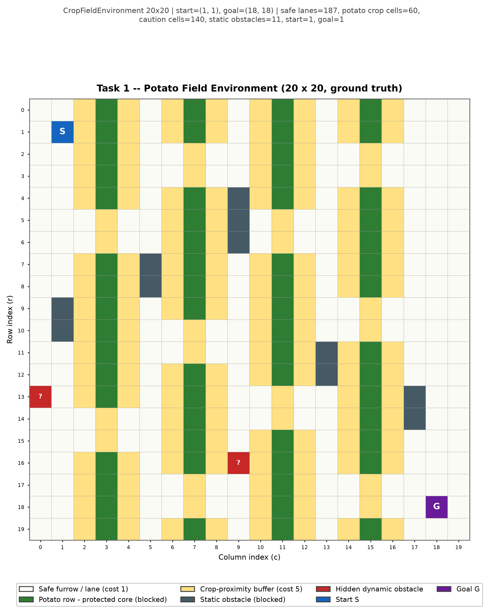
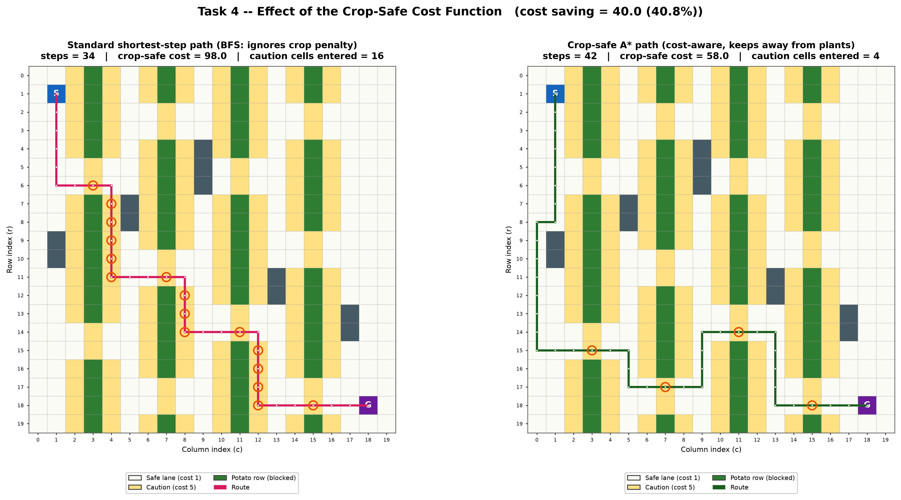
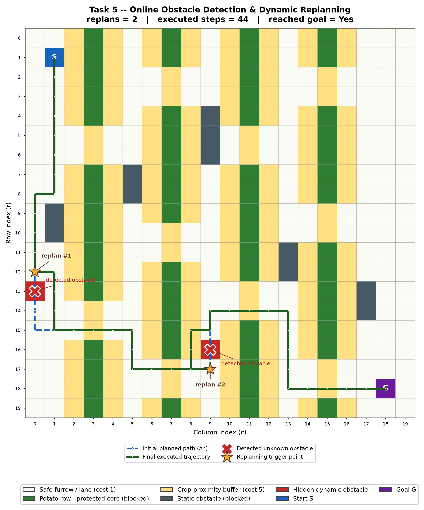

# AI-Based Crop-Safe Path Planning for an Autonomous Potato-Field Robot

 **IIITN Group project — Artificial Intelligence / Search Algorithms**
> Shlok Dadhich(BT24CSA001), Saurabh Jadhav(BT24CSA022), Arijeet Tripathi(BT24CSA020), Sanchit Garg(BT24CSA018) · Tasks 1–6 · Pure Python + `numpy` + `matplotlib`

An autonomous agricultural robot has to drive from the corner of a potato field to a
monitoring station without crushing plants, without hitting stones or tools, and
without wasting energy by scraping along the crop rows. This project models that
problem as a **4-connected grid search problem with a weighted crop-safe cost
function**, implements **BFS, DFS, Greedy Best-First Search and A\*** from scratch,
and adds an **online planning loop**: the robot detects unknown obstacles with a
one-cell sensor and re-runs A\* from its current position whenever its plan is
invalidated.

---

## 1. Overview

| Item | Value |
|---|---|
| Field | 20 × 20 grid |
| Start / Goal | `S = (1, 1)` / `G = (18, 18)` |
| Actions | 4-connected (UP, DOWN, LEFT, RIGHT) — no diagonals |
| Algorithms | BFS, DFS, Greedy Best-First, A\* |
| Heuristic | Manhattan distance (admissible + consistent) |
| Hidden obstacles | 2, planted on the initial optimal A\* route |
| Sensor range | 1 cell (4-neighbourhood) |
| Figures | 4 × 300 DPI PNG in `output/` |
| Tables | console + `output/performance_comparison.csv` + `.md` |

### Repository structure

```
AI_CropSafe_PathPlanning_GroupXX/
├── output/                      # Auto-generated plots, CSV and Markdown tables
├── src/
│   ├── __init__.py
│   ├── environment.py           # Task 1: 20x20 field grid + crop-safe buffer logic
│   ├── problem.py               # Tasks 2 & 4: state space, transition model, cost
│   ├── heuristics.py            # Task 3: admissible Manhattan / crop-aware heuristics
│   ├── algorithms.py            # Task 3: BFS, DFS, Greedy Best-First, A*
│   ├── dynamic_replanning.py    # Task 5: online detection + repeated A* replanning
│   └── visualizer.py            # Tasks 1, 3, 5, 6: matplotlib figures
├── main.py                      # Master runner: Tasks 1–6 end-to-end
├── requirements.txt             # numpy, matplotlib
└── README.md
```

---

## 2. Field model (Task 1)

The field is a NumPy array of integer cell encodings. Two *separate* crop-protection
zones are modelled:

| Value | Meaning | Traversable | Step cost |
|---|---|---|---|
| `0` | Safe travelling cell — furrow / lane between rows | ✅ | `1` |
| `1` | Potato crop row / strict crop-protection core | ❌ | `∞` |
| `2` | Crop-proximity caution zone (4-adjacent to a crop row) | ✅ | `5` |
| `3` | Static known obstacle (stone, farm tool) | ❌ | `∞` |
| `4` | Unknown / dynamic obstacle (hidden until detected) | ❌ | `∞` |
| `5` | Start `S = (1, 1)` | ✅ | `1` |
| `6` | Goal `G = (18, 18)` | ✅ | `1` |

Design choices:

* **Four vertical potato rows** (columns 3, 7, 11, 15) with **2–3 cell wide
  travelling lanes** between them.
* Each crop row is interrupted by narrow **furrow openings** (gaps) that form the
  only legal crossings, so the robot has to choose *where* to cross instead of
  following a trivial straight line.
* The caution zone is **derived automatically**: every passable cell 4-adjacent to a
  crop row becomes value `2`. This is what makes "hug the crop wall" expensive while
  the lane centre stays cheap.
* **11 static obstacles** create pinch points and a long wall that force real
  detours.
* **2 hidden obstacles** are planted directly on the initial optimal A\* route, so
  online detection and replanning is guaranteed to happen in Task 5.



---

## 3. Mathematical problem formulation (Task 2)

**State space.** `S = {(r, c) | 0 ≤ r < 20, 0 ≤ c < 20}` — every cell of the field.
The state is the robot's position; the map is part of the problem, not the state.

**Initial state.**
`s0 = (1, 1)`

**Actions.**
`A(s) = { UP (-1, 0), DOWN (+1, 0), LEFT (0, -1), RIGHT (0, +1) }`
Diagonal movement is forbidden: a diagonal step between two plants would clip
their canopy and roots, which is physically unsafe.

**Transition model.**
```
Result(s, a) = s' = (r + dr, c + dc)
```
legal iff `0 ≤ r' < 20`, `0 ≤ c' < 20` and `grid[r'][c'] ∉ {1, 3, 4}`.

**Goal test.**
`IsGoal(s) = True ⟺ s = (18, 18)`

**Path-cost function.**
```
            ⎧ 1     if s' is a normal safe cell        (values 0, 5, 6)
c(s, a, s') = 5     if s' is a crop-proximity cell      (value 2)
            ⎩ ∞     if s' is crop core or an obstacle   (values 1, 3, 4)

g(n) = Σ c(s, a, s')  along the path from s0 to n
```

Because a caution cell costs `5` while a safe cell costs `1`, a detour of up to four
extra steps is cheaper than a single caution cell — the robot therefore prefers the
safer centre of a lane whenever such a route exists. Crossing a crop row is only
possible through a furrow opening, and those openings necessarily contain caution
cells; A\* pays that unavoidable penalty and nothing more.

**Heuristic (Task 3).**
```
h(n) = |r_n - r_goal| + |c_n - c_goal|          (Manhattan distance)
```
*Admissible:* with 4-connected moves each step changes exactly one coordinate by
one, so at least `h(n)` steps are required; each step costs at least 1, hence
`h*(n) ≥ h(n) · 1 = h(n)`. A\* is therefore optimal.
*Consistent:* moving one cell changes `h` by at most 1 and every edge costs at
least 1, so `h(n) ≤ c(n, n') + h(n')`; each node is expanded at most once.
The console prints this proof (`src/heuristics.py :: explain_heuristic`), and the
runner additionally cross-checks A\* with a stronger *crop-aware* admissible
heuristic (Manhattan + unavoidable caution penalties in intermediate crop
columns) — both return the same optimal cost.

**Solution.** A path `π = ⟨s0, …, sk⟩` with `sk = G`, every transition legal,
minimising `g(π)`.

---

## 4. Algorithms (Task 3)

All four searches return the same `SearchResult` dataclass:

| Field | Meaning |
|---|---|
| `algorithm_name` | `BFS` / `DFS` / `Greedy BFS` / `A*` |
| `path` | list of `(row, col)` from start to goal |
| `reached_goal` | `bool` |
| `path_length_steps` | number of edges in the path |
| `total_path_cost` | Σ crop-safe cell-entry costs |
| `expanded_nodes_count` | nodes removed from the frontier |
| `expanded_order` | expansion sequence, used for the visualisation |
| `execution_time_ms` | measured with `time.perf_counter()` |

| Algorithm | Frontier | Objective |
|---|---|---|
| BFS | FIFO `collections.deque` | fewest steps, blind to crop penalty |
| DFS | LIFO `list` with cycle checking | any path, often long and wasteful |
| Greedy Best-First | `heapq` on `h(n)` | sprints at the goal, ignores cost |
| A\* | `heapq` on `g(n) + h(n)` with best-`g` tracking | optimal crop-safe path |

---

## 5. Crop-safe verification (Task 4)



* BFS returns the **minimum-step** route (34 steps, the Manhattan lower bound) but
  enters **16 crop-proximity cells**, giving a crop-safe cost of **98.0**.
* A\* accepts **8 extra steps** and enters only **4 caution cells**, reducing the
  crop-safe cost to **58.0 — a 40.8 % reduction**.
* The four caution cells A\* does enter are exactly the furrow openings where a crop
  row has to be crossed; every other cell of its route is a safe lane cell.
* No algorithm enters a potato row (`1`) or a static obstacle (`3`): the
  transition model makes this impossible by construction, and `path_is_valid()`
  asserts it in the runner.

| Algorithm | Safe cells | Caution cells | Crop core | Static obstacle | Steps | Crop-safe cost |
|---|---|---|---|---|---|---|
| BFS | 18 | 16 | 0 | 0 | 34 | 98.0 |
| DFS | 80 | 94 | 0 | 0 | 174 | 550.0 |
| Greedy BFS | 21 | 21 | 0 | 0 | 42 | 126.0 |
| **A\*** | **38** | **4** | **0** | **0** | **42** | **58.0** |

---

## 6. Online detection & dynamic replanning (Task 5)

The robot keeps two maps:

* `robot_map` — its belief: hidden obstacles (`4`) appear as safe cells (`0`);
* `ground_truth` — reality, where the hidden obstacles exist.

Control loop (`src/dynamic_replanning.py`):

1. Plan once with A\* from `S` to `G` on `robot_map`.
2. Execute the route cell by cell. At every cell, scan the 4-neighbourhood in the
   **ground truth**.
3. A newly discovered obstacle is written into `robot_map` and logged with the
   robot's current coordinates.
4. **If and only if** that obstacle lies on the remaining planned route,
   increment the replan counter and re-run A\* from the robot's *current* position
   to `G` on the updated map.
5. Continue until `G` is reached (or no route remains).

In this field the two hidden obstacles `(13, 0)` and `(16, 9)` are detected at
robot positions `(12, 0)` and `(17, 9)` respectively, triggering **two
replans**; the robot reaches the goal in 44 executed steps.



---

## 7. Installation & run

```bash
# 1) clone / unzip the project, then:
cd AI_CropSafe_PathPlanning_GroupXX
pip install -r requirements.txt

# 2) run everything (prints the formulation, proof and both tables)
python main.py
```

* Requires Python 3.9+ (developed and verified on Python 3.12).
* `matplotlib` is forced to the headless `Agg` backend, so the script also works on
  a server or in CI without a display.
* All artefacts are written to `output/` relative to `main.py`, regardless of the
  current working directory.

Generated files:

| File | Content |
|---|---|
| `output/01_field_environment.png` | colour-coded field, coordinates, legend |
| `output/02_algorithm_paths_comparison.png` | BFS / DFS / Greedy / A\* (2 × 2) |
| `output/03_crop_safe_cost_effect.png` | shortest-step vs crop-safe route |
| `output/04_dynamic_replanning_simulation.png` | initial plan, detections, replans, trajectory |
| `output/performance_comparison.csv` | Table 1 as CSV |
| `output/performance_comparison.md` | Tables 1 and 2 as Markdown |

---

## 8. Performance comparison (Task 6)

### Table 1 — Static path-planning performance comparison

| Algorithm | Destination Reached | Path Length (Steps) | Total Crop-Safe Cost | Expanded Nodes | Execution Time (ms) |
|---|---|---|---|---|---|
| BFS | Yes | 34 | 98.0 | 310 | 0.59 |
| DFS | Yes | 174 | 550.0 | 203 | 0.43 |
| Greedy BFS | Yes | 42 | 126.0 | 57 | 0.15 |
| A\* | Yes | 42 | 58.0 | 213 | 0.54 |

### Table 2 — Online obstacle detection & replanning summary

| Experiment Phase | Destination Reached | Traversed Steps | Total Crop-Safe Cost | Replans Triggered | Total Expanded Nodes | Total Time (ms) |
|---|---|---|---|---|---|---|
| Phase 1 — initial plan (known map) | Yes | 42 | 58.0 | 0 | 213 | 0.58 |
| Phase 2 — online run (detection + replanning) | Yes | 44 | 68.0 | 2 | 453 | 1.22 |

> Timings are wall-clock measurements from a single reference run on the same
> machine; they vary slightly between runs. Path lengths, costs and expansion
> counts are deterministic.

---

## 9. Key observations

1. **BFS is step-optimal but crop-unsafe.** 34 steps is provably the shortest
   possible path, yet it enters 16 caution cells and costs 98.0 — 69 % more than A\*.
2. **A\* trades a few steps for crop safety.** It accepts 8 extra steps (42 vs 34)
   but reduces the crop-safe cost by 40.8 % (58.0 vs 98.0). This is exactly the
   behaviour the weighted cost function was designed to produce.
3. **Greedy Best-First is fast but poor.** It expands only 57 nodes (the least of
   all algorithms) but its route is both longer (42 steps) and far more expensive
   (126.0) than A\*'s, because it ignores `g(n)`.
4. **DFS finds a legal path but is mechanically unacceptable.** 174 steps and 94
   caution cells — 9.5× the cost of A\*, and it still expands 203 nodes.
5. **A\* expands more nodes than Greedy but returns a cheaper path.** With the
   consistent Manhattan heuristic it expands every node with `f(n) ≤ C*` exactly
   once, which is the price of optimality.
6. **Online replanning costs effort but keeps the mission safe.** Two hidden
   obstacles force two replans; the executed route is 2 steps longer and 10 cost
   units more expensive than the optimistic plan, and total expanded nodes rise
   from 213 to 453. The robot still reaches the goal, which an open-loop planner
   would not (it would drive into the first hidden obstacle).
7. **The crop-aware heuristic expands fewer nodes (153 vs 213) for the same
   optimal cost**, confirming empirically that it is admissible.

---

## 10. Group members

| # | Name | Roll Number | Assigned Responsibility |
|---|---|---|---|
| 1 | _Member 1_ | _Roll No._ | Task 1 — Field environment, grid encoding, crop-safe buffer design |
| 2 | _Member 2_ | _Roll No._ | Task 2 — Formal problem formulation and transition model |
| 3 | _Member 3_ | _Roll No._ | Task 3 — Heuristics and BFS / DFS implementations |
| 4 | _Member 4_ | _Roll No._ | Task 3 — Greedy Best-First and A\* implementations, performance evaluation |
| 5 | _Member 5_ | _Roll No._ | Task 5 — Online obstacle detection and dynamic replanning |
| 6 | _Member 6_ | _Roll No._ | Task 6 — Visualisation, README, report and demonstration |

---

## 11. Notes on correctness and reproducibility

* The field, the hidden-obstacle placement and all search results are
  **deterministic**; only the millisecond timings vary.
* `CropFieldProblem.path_is_valid()` verifies for every returned path that it starts
  at `S`, ends at `G`, uses only cardinal moves and never enters a blocked cell.
* The hidden-obstacle seeding routine flood-fills the ground truth after each
  placement and only keeps placements that leave the field solvable.
* Figures are rendered with `matplotlib.use("Agg")` and saved at 300 DPI with
  `bbox_inches="tight"`.
